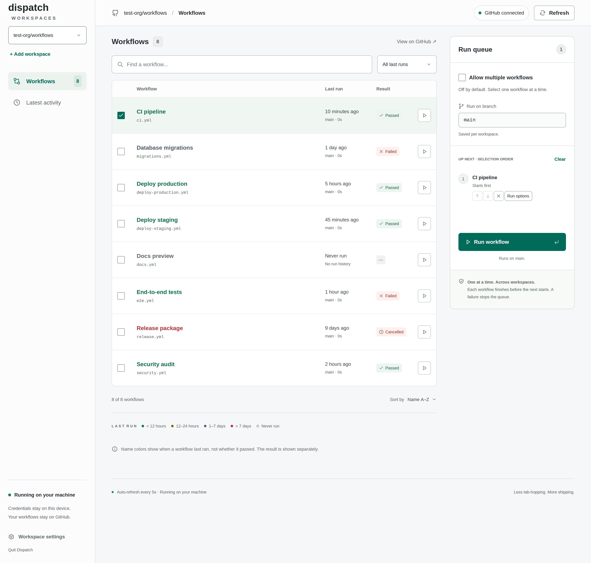

# Dispatch

A native desktop app for running GitHub Actions workflows in sequence.

Connect repository workspaces, inspect workflow history, and build an ordered queue. Each workflow must succeed before the next one starts.



## Features

- Run workflows in selection order, with controls to reorder or remove queued items.
- Fill in branch-specific workflow inputs, including text, boolean, number, choice, and environment inputs.
- Check connected repositories for active runs before launching and before each dispatch.
- See the latest run of each workflow, with separate recency colors and result badges.
- Edit text with native selection, clipboard shortcuts, and input method support.

## Getting started

### 1. Install and authenticate

Download the [latest release](https://github.com/skorotkiewicz/dispatch-workflows/releases/latest) for Linux x64, Windows x64, or macOS Intel or Apple Silicon. Linux archives contain `dispatch`, Windows archives contain `dispatch.exe`, and macOS archives contain `Dispatch.app`. Each release includes `SHA256SUMS` for verifying the archives.

The `dispatch-workflows-bin` AUR package installs the Linux app as `dispatch-workflows`.

Authenticate before opening Dispatch:

```sh
gh auth login --hostname github.com
```

Alternatively, provide `GH_TOKEN` or `GITHUB_TOKEN` in the application environment. Running workflows requires Actions write access and Contents read access. Private repositories require authentication. Restart Dispatch after changing authentication.

### 2. Connect your workspaces

Click **Add workspace**, enter `owner/repository` or its GitHub URL, and connect. Switch saved repositories using the sidebar.

Repositories and saved branch preferences survive restarting the app. Selections, search, filters, and input drafts stay separate per workspace while Dispatch is open and are cleared when it closes.

### 3. Select and run

1. Choose an existing branch under **Run on branch**. Click **Save** when it appears to persist the branch preference.
2. Search and select a workflow. Enable **Allow multiple workflows** to build a sequential queue.
3. Click **Run options** to prepare inputs for a selected workflow.
4. Click **Run workflow** or **Run workflows**. Dispatch walks through the input forms and validates every selected workflow before launching.

Workflows must be active and support `workflow_dispatch` on the selected branch and the repository's default branch.

## Workflow history

Workflow name colors show how long it has been since the last run, separately from whether it passed:

| Color | Last run |
| --- | --- |
| Green | Less than 12 hours ago |
| Yellow | 12 to 24 hours ago |
| Gray | 1 to 7 days ago |
| Red | More than 7 days ago |

Workflows without a run are labeled **Never run**. Search matches workflow names and paths. The filter and sort buttons cycle through their available modes. **Latest activity** lists the latest run of each workflow, newest first. Run timestamps and execution links open the corresponding run on GitHub.

Workflow metadata is cached for at least 30 seconds, or 3 seconds per workflow for larger repositories. **Refresh** bypasses that cache.

## Queue behavior

One queue runs at a time across saved workspaces. Dispatch checks other saved repositories for active runs before launch and again before each dispatch. It waits for active runs in the target repository before starting the next selected workflow.

A failure, cancellation, non-successful conclusion, monitoring error, or uncertain dispatch response stops the batch and skips pending workflows. Dispatch never automatically retries a workflow dispatch. Missing run IDs or mismatched run details also stop the batch. Dispatch monitors only the run ID returned by its dispatch request.

**Stop after current workflow** keeps monitoring a workflow already dispatched and skips pending items. It does not cancel runs on GitHub.

Keep Dispatch open while a queue runs. Closing the window during execution asks before quitting. Quitting discards the queue and stops monitoring; already dispatched GitHub runs continue. Queues are held in memory and never resume automatically.

The idle wait limit is 30 minutes and monitoring is limited to 24 hours. Dispatch polls running workflows every 10 seconds.

Exclusivity is best effort because GitHub provides no atomic repository-wide dispatch lock. Other callers can start runs between checks. Use GitHub Actions `concurrency` when exclusivity must cover every caller.

## Workspaces and settings

Use **Add workspace** to connect a repository and **Workspace settings** to remove one locally. Removing a workspace does not change its GitHub repository or workflows. Adding and removing workspaces is disabled while a queue runs; try again after it finishes.

Dispatch saves repositories, the active workspace, and saved branch preferences in `config.json` in the operating system's application configuration directory for `dispatch`. Set `DATA_DIR` to choose a different configuration directory. `GITHUB_REPO=owner/repository` bootstraps a workspace only when there is no saved configuration.

Settings use version 2 JSON. Invalid or unsupported settings produce an error and are not overwritten. A file lock prevents two Dispatch instances from sharing one configuration directory.

Credentials are read at startup and kept in memory. They are never written to workspace settings.

## Requirements

- Linux x64, Windows x64, or macOS Intel or Apple Silicon.
- A graphical session and compatible graphics driver.
- An internet connection to GitHub.com. GitHub Enterprise Server is not supported.

For development setup, checks, and release packaging, see [Contributing](CONTRIBUTING.md).
